# Galaxy S26 Ultra — Concept Site

An interactive, scroll-driven product page for the Samsung Galaxy S26 Ultra, built with Next.js, React Three Fiber and GSAP. Real-time 3D phones, a side-by-side comparison with the S25 Ultra, a configurator with AR, and live Galaxy AI demos. All specs come from Samsung's official product pages.

> Fan-made concept. Not affiliated with or endorsed by Samsung.

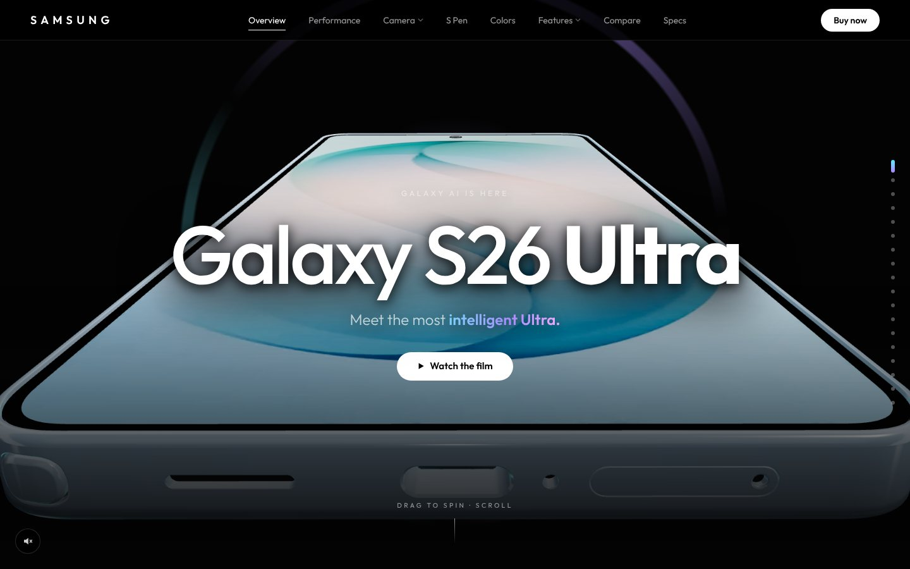

## Highlights

- **Scroll-choreographed 3D:** a single real-time phone model moves, turns and comes apart as you scroll. The S Pen slides out of its slot, and the phone fans out into every color.
- **Drag to spin:** grab the phone in the hero or either phone in Compare and spin it, with inertia and a soft snap back.
- **S26 Ultra vs S25 Ultra:** both phones side by side in 3D at true relative size, next to a spec table and the headline gains (+39% NPU, +24% GPU, +19% CPU).
- **Build your Ultra:** pick a color and storage and the price updates live. Each color has its own wallpaper on the screen.
- **View in your room (AR):** opens the selected color at real size (163.6 × 78.1 mm), using Scene Viewer / WebXR on Android and Quick Look on iPhone.
- **Galaxy AI demos:** Live Translate, Circle to Search and Photo Assist play as short animated stories.
- **Camera stories:** a 0.6x → 100x Space Zoom you scroll through, and a night shot comparison with a draggable before/after slider.
- **Privacy Display, Super Steady, 60W charging race, layer-by-layer teardown:** each section has its own 3D or animated demo.
- **Watch the film:** one button runs the whole page as a guided, auto-scrolling tour that you can pause, resume or exit.
- **Details:** an optional synthesized UI sound, section dots, a grouped menu, a loader and ambient lighting per section.

## Screenshots

| | |
|---|---|
| 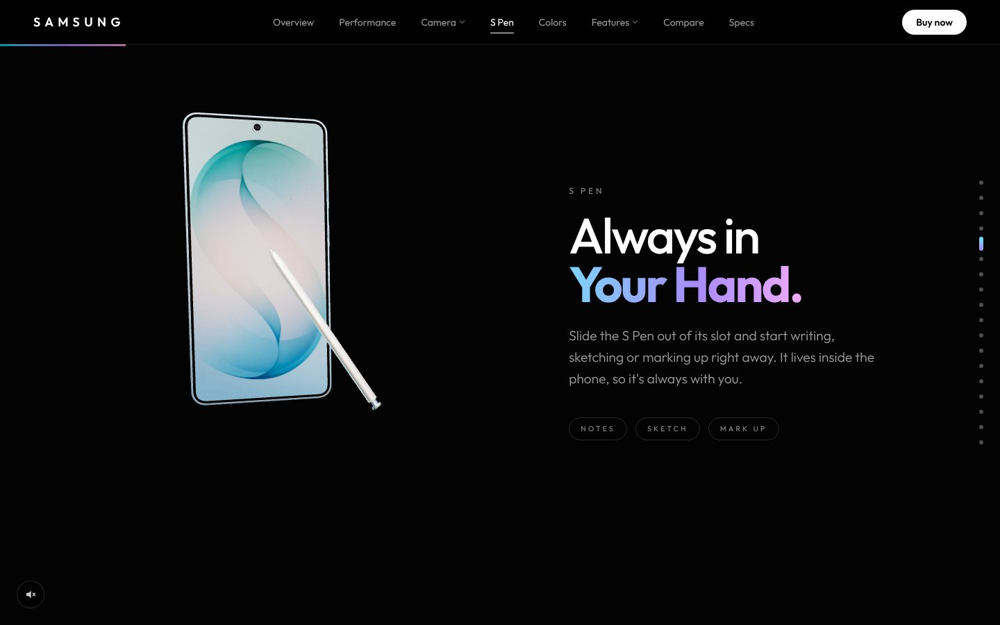 | 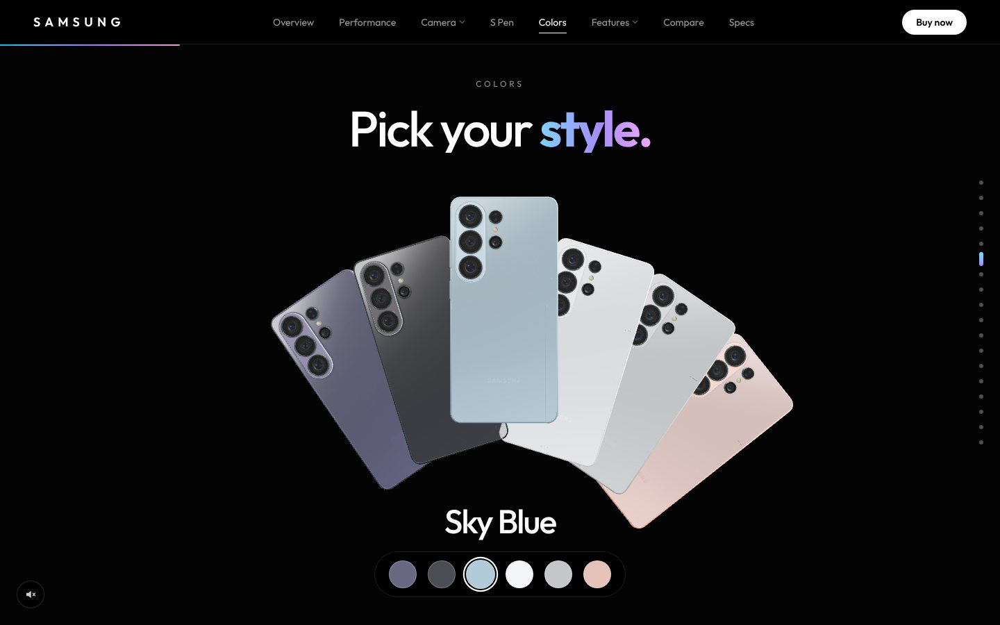 |
| **S Pen:** slides out as you scroll | **Colors:** six finishes fan out |
| 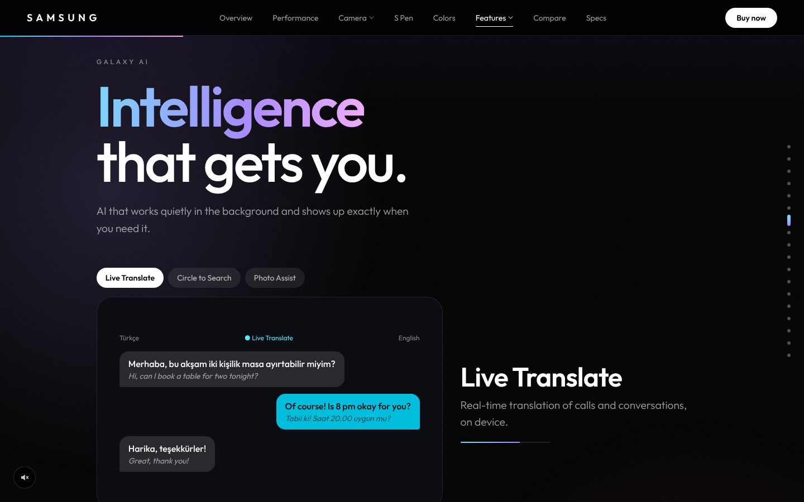 | 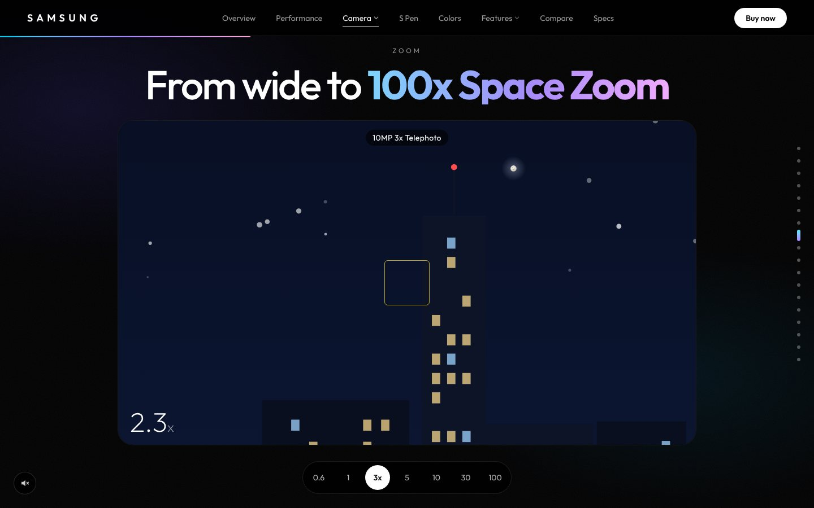 |
| **Galaxy AI:** live, animated demos | **100x Space Zoom:** scroll to zoom |
| 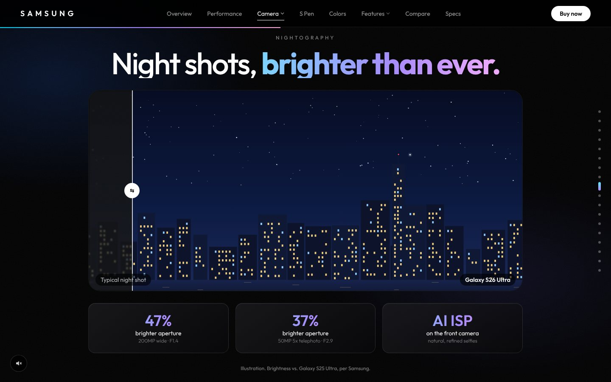 | 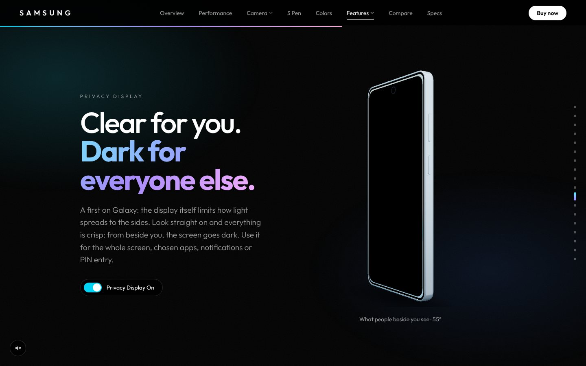 |
| **Nightography:** drag the before/after slider | **Privacy Display:** the screen darkens at an angle |
| 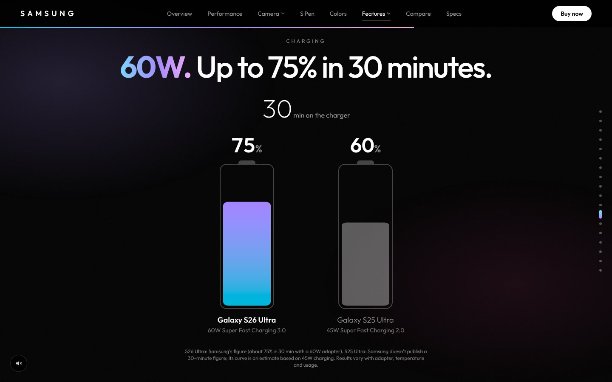 | 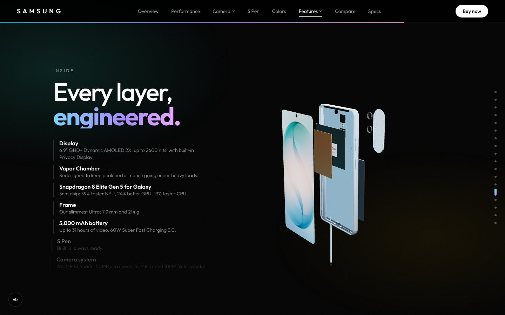 |
| **60W charging:** a race against the S25 Ultra | **Inside:** every layer, exploded |
| 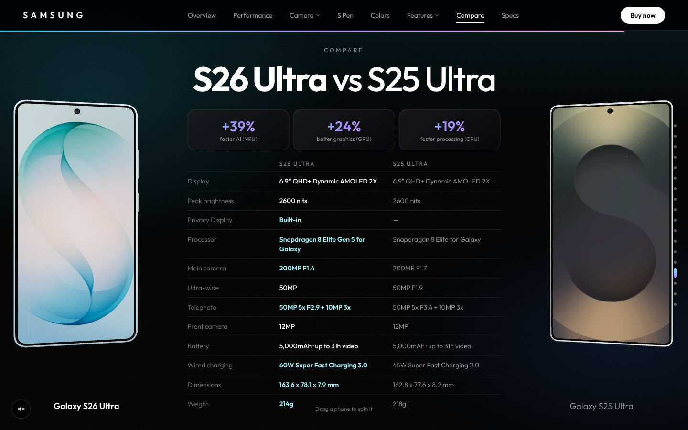 | 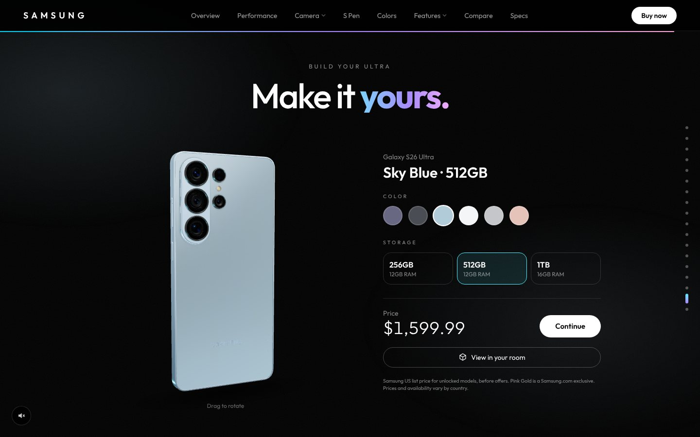 |
| **Compare:** S26 Ultra vs S25 Ultra | **Build your Ultra:** configurator + AR |

### Mobile

<p>
  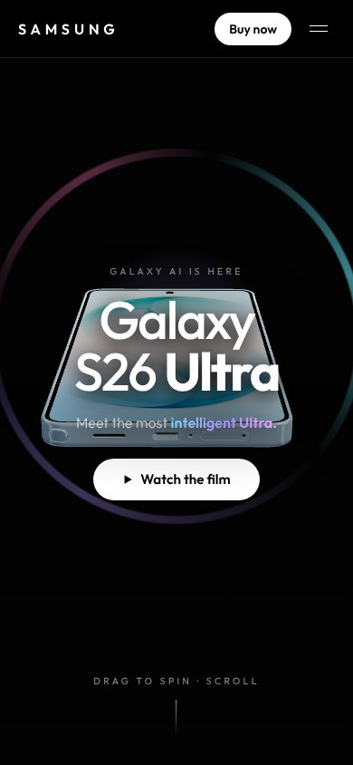
  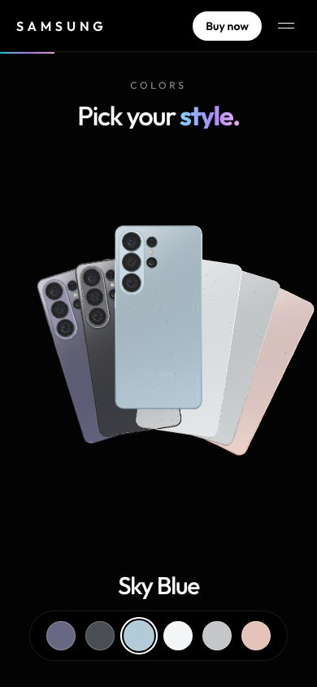
  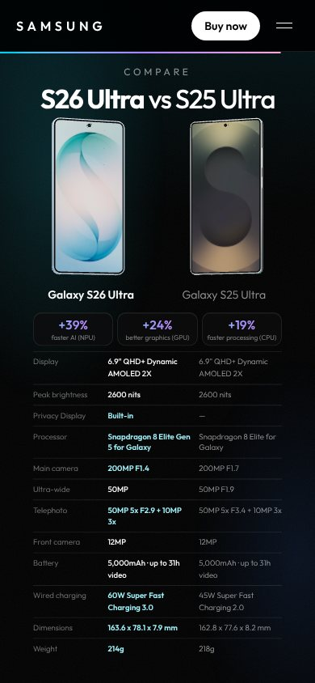
  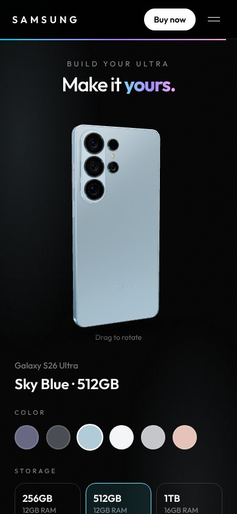
</p>

## Tech stack

- [Next.js 16](https://nextjs.org) (App Router, Turbopack), React 19, TypeScript
- [Tailwind CSS v4](https://tailwindcss.com)
- [three.js](https://threejs.org), [@react-three/fiber](https://github.com/pmndrs/react-three-fiber), [@react-three/drei](https://github.com/pmndrs/drei)
- [GSAP ScrollTrigger](https://gsap.com/scrolltrigger) and [Lenis](https://lenis.darkroom.engineering) smooth scrolling
- [&lt;model-viewer&gt;](https://modelviewer.dev) for AR (loaded only when opened)

## Performance

- Draco-compressed GLB models, preloaded when the browser is idle.
- Render on demand: canvases only draw while something moves, and pause entirely off screen.
- Every 3D section after the hero shares a single WebGL canvas (drei `View` + scissor), so there is no extra GPU context per section.
- Shaders and textures are compiled ahead of time, so sections don't stutter when they first appear.
- Lighthouse (desktop): Accessibility 100, Best Practices 100, SEO 100, CLS 0.001.
- Respects `prefers-reduced-motion`, has a skip link and full keyboard support, and passes contrast checks.

## Getting started

```bash
npm install
npm run dev
```

Open [http://localhost:3000](http://localhost:3000).

Production build:

```bash
npm run build
npm start
```

AR needs HTTPS on a real device, so test it on a deployed URL (for example, on Vercel).

## Project structure

```
app/            page layout, fonts, global styles
components/     one component per section, plus the shared 3D scene and canvases
lib/            specs data, colors and wallpapers, scroll and section helpers, sound
public/model/   Draco-compressed phone models and AR models (one per color)
public/wallpapers/  per-color screen wallpapers
docs/screenshots/   images used in this README
```

## Credits

- Specifications: [Samsung](https://www.samsung.com) official Galaxy S26 Ultra and S25 Ultra product pages.
- S Pen and Galaxy S25 Ultra 3D models by [vmmaniac](https://sketchfab.com/vmmaniac), licensed under [CC BY 4.0](https://creativecommons.org/licenses/by/4.0/).
- [&lt;model-viewer&gt;](https://github.com/google/model-viewer) by Google, Apache-2.0.
- Font: [Outfit](https://fonts.google.com/specimen/Outfit) (SIL Open Font License).

Samsung, Galaxy and related marks are trademarks of Samsung Electronics Co., Ltd. This is a non-commercial portfolio project.

Designed and built by **Hasan Alp Güngör**.
